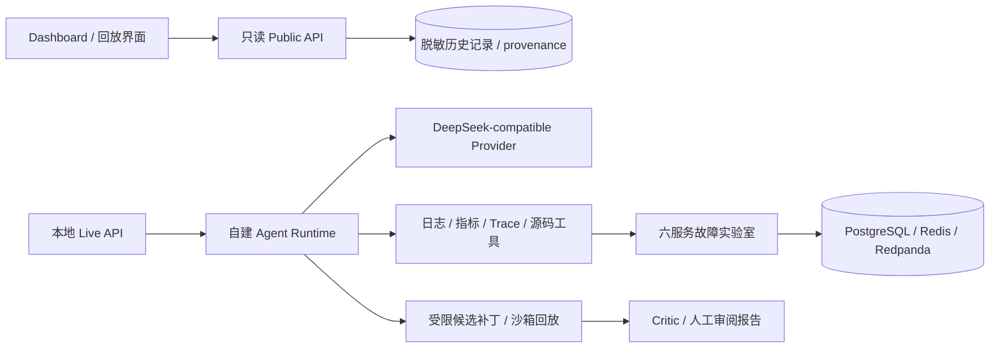
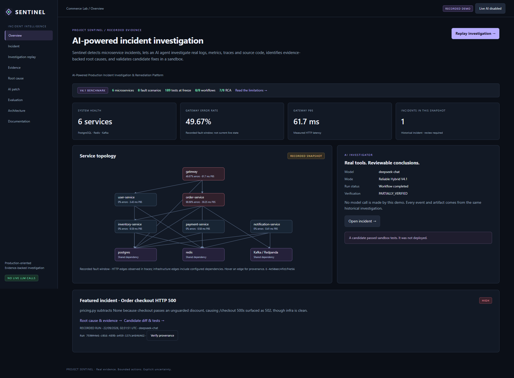

# Project Sentinel

面向微服务故障排查的 AI Agent 实验与求职展示项目。Agent 读取日志、指标、Trace 与源码，通过工具和证据引用形成根因判断，再对受限候选补丁进行沙箱验证。

**默认演示为 RECORDED DEMO：真实历史运行的只读回放。** 它不代表持续运行的生产系统。Live Lab 需要单独启用；候选补丁不会自动部署。

## 1. 项目简介

项目用八类受控故障比较规则、LLM 与 Hybrid 调查流程，保留失败实验、恢复过程和证据限制。重点展示 Agent 状态、工具权限、证据交接、恢复与验证，而非只展示一段模型回答。

冻结 V4.1 的八个场景完成 8/8、根因正确 7/8，仅是小规模受控实验。当前引用保护修复尚未重跑完整付费 Benchmark，不能将历史成绩赋给当前代码。

## 2. 技术栈

| 层 | 已使用技术 |
| --- | --- |
| 后端与 Agent | Python、FastAPI、asyncio、Pydantic、HTTPX、自建 Runtime |
| 实验依赖 | PostgreSQL、Redis、Redpanda/Kafka-compatible、aiokafka |
| 可观测性 | OpenTelemetry、OTLP Collector、Jaeger、Prometheus、结构化日志 |
| 前端 | 原生 HTML/CSS/JavaScript/SVG，历史回放与文档阅读器 |
| 工程 | Docker Compose、pytest、Node test runner、Playwright |

没有已实施的 Java 服务、LangGraph、RAG 或向量数据库。

## 3. 系统架构



默认 `compose.yaml` 只有录制演示；完整实验室在 `compose.live.yaml`，两种模式的依赖和授权不同。

## 4. 核心功能

| 能力 | 源码与证据 |
| --- | --- |
| 只读回放、根因、证据和补丁展示 | [public_demo.py](sentinel/public_demo.py)、[portfolio/data](portfolio/data/) |
| 状态、预算、结构化修复、响应日志与恢复 | [runtime_agent.py](sentinel/runtime_agent.py)、[runtime_state.py](sentinel/runtime_state.py) |
| 工具调用与真实故障实验室 | [runtime_tools.py](sentinel/runtime_tools.py)、[services](services/) |
| 受限补丁与 Critic | [generic_patching.py](sentinel/generic_patching.py)、[Claims Matrix](CLAIMS_MATRIX.md) |

## 5. 关键工程实现与源码位置

- **调查结论需要能追溯到实际读过的证据。** Runtime 保存证据 ID、读取记录和引用，Critic 交接必须保留必要引用；上下文装不下时明确失败。历史缺陷与当前保护见 [独立审计](docs/independent-final-audit.md)。
- **上游失败不能变成无限循环。** 有界状态、修复预算、熔断、检查点与响应日志约束执行；历史包含真实 SIGKILL 恢复和本机 Provider fixture，两者不混称云端验证。提交前丢失响应仍可能重复计费。
- **公开展示不需要模型或数据库权限。** 独立 Public API 仅读取录制文件并拒绝变更请求，见 [只读边界测试](tests/test_portfolio.py)。2026-10-18 前一阶段记录 78 项离线测试通过；本次仅验收文档，没有启动 Live Lab。

## 6. 本地部署教程

<a id="quick-start"></a>

需要 Docker Engine/Desktop 与 Compose v2。只启动录制演示，不需要 API Key：

```powershell
git clone https://github.com/tangwencan666/Project-Sentinel.git
cd Project-Sentinel
docker compose up -d --build
```

打开 `http://localhost:18082`。端口冲突时设置 `DEMO_PORT`；首次构建需要依赖下载。可用 `python scripts/check_environment.py --mode recorded` 检查环境。停止仅使用本项目 `docker compose down`，不删除实验室数据卷。

<a id="recorded-demo"></a>

Recorded Demo 的播放、倍速与跳转只改变回放游标。它没有外部公开域名，也不执行实时诊断。需要 Live Lab 时先阅读 [部署边界](docs/deployment-public-demo.md) 和 [架构](docs/architecture.md)，再单独配置模型与实验依赖；本次文档验收未启用 Live、注入故障或执行收费模型测试。

## 7. 真实运行截图



图片与 `portfolio/data/` 来自既有真实录制，本次文档验收没有生成新界面。完整来源、原始运行 ID 与实验限制见 [独立审计](docs/independent-final-audit.md) 和 [演示指南](docs/demo-5min.md)。

## 8. 测试结果与已知限制

| 验证 | 结果与边界 |
| --- | --- |
| 2026-10-18 前一阶段 Public API 专项 | 78 passed；只读记录、变更拒绝、路径与展示边界；无付费调用 |
| 2026-09-23 历史独立审计 | 后端 287、前端 17；另有浏览器与 HTTP 检查，不能累计成真实模型样本数 |
| 冻结 V4.1 Benchmark | 8 场景、7 个根因正确；八个 Critic 均为 PARTIALLY_VERIFIED |
| 当前付费 Benchmark / 生产压测 | 本次文档验收未执行 |

```powershell
python -m pytest tests/test_portfolio.py -q
npm test
```

公开模式没有实时多租户 RBAC、通用自动修复部署或 exactly-once 计费保证。沙箱共享内核；依赖仍有待处理的漏洞债务。不得把固定故障域结果推广为生产准确率或任意仓库修复能力。

[本次文档验收验证](docs/PORTFOLIO_VERIFICATION.md) · [技术栈](docs/tech-stack.md) · [面试问题](docs/interview-qa.md) · [完整实验方法](docs/phase4-evaluation.md) · [原 README](docs/history/README.before-portfolio-20261018.md)

[本地验收记录](docs/LOCAL_ACCEPTANCE.md) · [测试证据及版本索引](docs/TEST_EVIDENCE.md)
