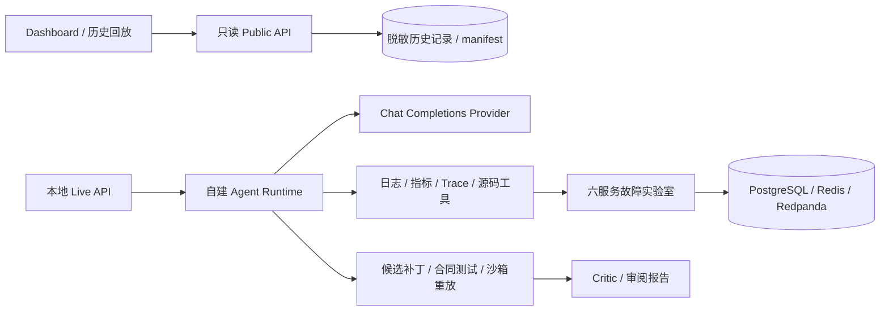

[中文](README.md) | [English](README_EN.md)

# Project Sentinel

面向微服务故障排查的 AI Agent 工程实践项目：从日志、指标、Trace 和源码中收集证据，形成可追溯的根因判断，并在受限沙箱中验证候选补丁。

项目围绕“结账接口报错时，Agent 如何调查、如何证明结论、失败后如何恢复”展开，包含六服务故障实验室、自建 Agent Runtime、评测记录和可交互的历史回放，适合从 Agent 开发、后端工程和可观测性三个角度阅读。

**默认启动的是 RECORDED DEMO，即真实历史调查的只读回放。** 运行演示无需 API Key；实时调查需要单独启动 Live Lab。项目处于实验与工程展示阶段，候选补丁没有自动部署到生产环境。

阅读入口：[统一中文导航](docs/index.md) · [Agent Runtime](docs/agent-runtime.md) · [五分钟演示](docs/demo-5min.md) · [本地部署](#本地部署)

## 核心功能

| 功能 | 已实现内容 | 实现位置 |
| --- | --- | --- |
| 故障实验室 | 六个微服务及八类受控故障：慢查询、连接池耗尽、N+1、缓存失效压力、Kafka 消费积压、下游超时、重试风暴、HTTP 500 代码异常 | [services/](services/)、[scenarios.py](sentinel/scenarios.py) |
| Agent 调查 | 支持规则、Pure LLM 与 Hybrid 流程；通过受控工具读取遥测和源码，记录假设、证据及根因 | [agent.py](sentinel/agent.py)、[hybrid.py](sentinel/hybrid.py)、[runtime_agent.py](sentinel/runtime_agent.py) |
| 运行控制与恢复 | 持久化调查状态、工具回执与模型响应；提供预算约束、结构化输出修复、重复失败熔断及检查点恢复 | [runtime_state.py](sentinel/runtime_state.py)、[checkpoints.py](sentinel/checkpoints.py)、[provider.py](sentinel/provider.py) |
| 候选补丁验证 | 对 pricing、payment、order、inventory 四类受限业务函数生成候选，执行 AST 校验、不可变合同测试和三服务 HTTP 重放，再交由 Critic 复核 | [generic_patching.py](sentinel/generic_patching.py)、[multiservice_sandbox.py](sentinel/multiservice_sandbox.py) |
| 历史回放与结果查看 | 按原事件顺序查看调查、错误、恢复、证据、根因和补丁；展示不同版本的评测结果与来源清单 | [public_demo.py](sentinel/public_demo.py)、[web/](web/)、[portfolio/data/](portfolio/data/) |

播放、倍速和跳转只改变回放游标，不重新调用模型或执行工具。停止故障注入与代码修复是两种不同操作；历史评测和当前源码也分别记录。

## 技术栈

技术选择以 [requirements.txt](requirements.txt)、[requirements.lock](requirements.lock)、[package.json](package.json) 和 Compose 配置为依据。

| 层次 | 技术 | 在项目中的作用 |
| --- | --- | --- |
| 后端 | Python、FastAPI、Uvicorn、Pydantic、asyncio | Incident API、六服务实验室、数据契约与异步调查流程；Docker 镜像使用 Python 3.12 |
| Agent 与模型 | 自建 Agent Runtime、HTTPX、兼容 Chat Completions 的 Provider | Tool Calling、结构化结果、用量记录；冻结云端实验使用 deepseek-chat |
| 数据与消息 | PostgreSQL 16、psycopg/pool、Redis 7、Redpanda、aiokafka | 业务 SQL、连接池、缓存和 Kafka 兼容消息生产/消费 |
| 可观测性 | OpenTelemetry、OTLP Collector、Jaeger、Prometheus | 跨服务 Trace、指标和结构化日志关联 |
| 前端 | 原生 HTML、CSS、JavaScript、SVG | Dashboard、拓扑、回放控制和文档阅读器 |
| 运行与验证 | Docker Compose、pytest、Node test runner、Playwright | 环境编排、后端/合同测试、前端单测与浏览器验证 |

Agent 编排由仓库内的 Python 模块实现，未使用 LangGraph。Node 与 Playwright 用于开发验证，默认演示运行不依赖 Node。详细范围见 [实际技术栈](docs/tech-stack.md)。

## 系统架构



| 模块 | 职责与调用关系 |
| --- | --- |
| `sentinel/public_demo.py` | 默认入口；独立读取录制文件并校验 manifest，不导入 Live Agent、数据库或 Provider 模块 |
| `sentinel/api.py` | 本地 Live 入口；提供事故、遥测、调查和恢复接口，按显式模式调用调查实现 |
| `sentinel/runtime_agent.py` | 协调 Triage、Planner、Investigator、候选生成和 Critic；将执行进度交给检查点存储 |
| `sentinel/runtime_tools.py`、`sentinel/tool_registry.py` | 校验当前阶段、工具名称与参数；调用观测适配器和源码工具，保存证据与工具回执 |
| `sentinel/evidence_compiler.py`、`sentinel/context_delivery.py` | 在上下文预算内组织证据，记录实际交付给模型的读取范围，保留必须引用的证据 |
| `sentinel/generic_patching.py`、`sentinel/multiservice_sandbox.py` | 约束候选文件和 AST，执行合同测试及真实依赖重放，输出风险与验证结果 |
| `services/`、`infra/` | 六服务业务实验室，以及 SQL、指标抓取、Trace 收集配置 |

Live 调查的主要流程为：事故信号 → Triage → Planner → 工具与证据 → 假设和根因提交 → 修复资格判断 → 候选测试/重放 → 确定性校验与 Critic → 报告。评分器使用实验真值评估结果，调查工具不提供真值注册表访问能力。

默认 `compose.yaml` 只运行只读演示；`compose.live.yaml` 才启动完整实验室。部分早期设计文档保留旧版本行为，阅读当前实现时请结合 [架构速记](docs/architecture-cheatsheet.md)、[独立审计](docs/independent-final-audit.md) 和源码。

## 核心技术亮点

- **把调查状态与对话历史分开管理。** `InvestigationState` 保存假设、错误、读取记录、待执行动作和分类预算；结构化错误携带修复建议，重复失败受到熔断约束，避免仅靠追加 Prompt 推进调查。
- **证据引用关联实际读取范围。** 工具结果进入证据账本，根因提交校验 Evidence ID 与源码行范围；Critic 所需证据必须保留，超过上下文预算时显式失败。上下文压缩记录遗漏项和估算口径，不把字符估算当作 Provider 实际 token 用量。
- **恢复考虑持久化边界。** 工具回执支持复用已完成调用；模型响应日志与逻辑请求摘要支持恢复时重放。远端响应尚未落盘时仍可能重复请求或计费，当前实现没有端到端 exactly-once 保证。
- **修复验证包含行为约束。** 候选只能修改允许的业务函数，不能改测试或评测真值；在原版与候选上分别执行合同测试、HTTP 重放及依赖观测。财务逻辑标为 HIGH risk，通用候选禁止自动 Apply。
- **展示入口与运行入口隔离。** Public API 拒绝非 GET/HEAD 请求，镜像不包含 Live 执行模块或密钥挂载；启动时校验录制数据哈希，前端将外部观测作为不可信文本渲染。

上述实现可以分别从 [Runtime](sentinel/runtime_agent.py)、[工具执行](sentinel/runtime_tools.py)、[证据编译](sentinel/evidence_compiler.py)、[Provider](sentinel/provider.py) 和 [补丁校验](sentinel/generic_patching.py) 追踪。审计保留了历史缺陷、失败实验和修复边界，见 [Claims Matrix](CLAIMS_MATRIX.md)。

## 本地部署

### 环境要求

- Git、Docker Engine/Desktop 和 Docker Compose v2；首次构建需要下载镜像与 Python 依赖。
- 只读演示不需要本机 Python、Node、数据库或模型 API Key。
- 本机执行 Python 验证命令时，建议使用与容器一致的 Python 3.12；运行前端单测另需支持 `node --test` 的 Node。

### 启动只读演示

```sh
git clone https://github.com/tangwencan666/Project-Sentinel.git
cd Project-Sentinel
docker compose up -d --build
```

打开 [本地演示](http://localhost:18082)。默认端口只绑定回环地址；首次启动可用以下命令查看状态：

```sh
docker compose ps
docker compose logs --tail=50 sentinel-demo
```

`.env` 对只读演示是可选的。若 `18082` 被占用，可在 PowerShell 中设置端口后重新启动：

```powershell
$env:DEMO_PORT = "18084"
docker compose up -d --build
```

此时访问 [备用端口](http://localhost:18084)。可选环境检查需要本机 Python：

```sh
python scripts/check_environment.py --mode recorded --port 18084
```

默认端口无需传入 `--port`。停止演示使用 `docker compose down`。

### 启动本地 Live Lab

完整实验室运行六个业务服务、数据库、缓存、消息与可观测组件。先复制配置模板；如果已有 `.env`，直接编辑现有文件，保留原配置。

```powershell
if (-not (Test-Path .env)) { Copy-Item .env.example .env }
```

在本地 `.env` 中填写 `LLM_BASE_URL`、`LLM_MODEL`、`LLM_API_KEY`，并显式设置 `LIVE_AI_ENABLED=true`。随后执行：

```sh
docker compose -f compose.live.yaml up -d --build
python scripts/check_environment.py --mode live
```

第二条命令需要本机 Python，只检查环境和只读观测，不发送模型请求。打开 [Live 工作区](http://localhost:18083/live.html)；创建调查会使用真实模型额度，故障控制会影响本地实验服务。`LIVE_AI_ENABLED=false` 时，故障/调查控制、自动检测派发与自动恢复关闭。完整说明见 [部署文档](docs/deployment-public-demo.md)。

停止 Live Lab 使用 `docker compose -f compose.live.yaml down`，切换模式无需删除数据卷。密钥只保存在本地，完整实验室仅面向可信本机环境。

## 测试与验证

只读 API 和前端单测可独立执行，不需要启动 Live Lab 或调用模型。在新的 Python 虚拟环境中安装验证所需依赖：

```sh
python -m pip install fastapi==0.115.12 httpx==0.28.1 pytest==8.4.1 -c requirements.lock
python -m pytest tests/test_portfolio.py -q
npm test
```

`npm test` 使用 Node 内置 test runner，不需要下载 Playwright。开发完整后端时使用 `python -m pip install -r requirements.txt -c requirements.lock`；完整后端与浏览器验证的环境要求见 [测试证据](docs/TEST_EVIDENCE.md)。

| 证据范围 | 可核实结果与适用边界 |
| --- | --- |
| 冻结 V4.1 Benchmark | 八个受控场景，工作流完成 8/8、根因正确 7/8；八个 Critic 结果均为 `PARTIALLY_VERIFIED`，重试风暴仍误判 |
| 历史独立审计 | 记录后端 287、前端 17 项通过；属于具名历史测试批次，不代表本次重跑完整后端 |
| 本轮全仓库中文化验证 | 命令、环境与实际结果见 [中文化验证记录](docs/localization-validation.md)；[首轮首页验证](docs/validation-20261022.md) 单独保留 |

冻结成绩来源见 [录制评测数据](portfolio/data/evaluation.json)、[独立审计](docs/independent-final-audit.md) 和 [测试证据索引](docs/TEST_EVIDENCE.md)。冻结版本存在 Critic 引用交接缺陷；当前代码已加引用保护，但没有重跑完整付费 Benchmark，因此不能把历史 8/8 赋给当前源码。不同测试批次不累加为模型样本数。

## 项目目录结构

```text
sentinel/          # Agent Runtime、证据工具、候选校验、Live 与只读 API
services/          # 六服务业务实验室与受限业务函数
infra/             # PostgreSQL 初始化、Prometheus 与 OTLP 配置
web/               # Dashboard、历史回放、文档阅读器与本地 Live 页面
portfolio/data/    # 脱敏历史记录、评测投影与来源 manifest
tests/             # Runtime、合同、只读 API、回放和文档渲染测试
scripts/           # 环境检查、数据导出、审计与实验验证脚本
docs/              # 架构、部署、实验记录、截图与面试导读
compose.yaml       # 默认只读演示
compose.live.yaml  # 完整本地实验室
Dockerfile.demo    # 最小只读镜像
Dockerfile         # Live 实验镜像
requirements.txt   # Python 直接依赖
requirements.lock  # Python 依赖约束
README_EN.md       # 保留的原英文首页
```

历史脚本可能引用未随 Git 发布的 `evaluation/` 冻结包和本地实验产物；源码仓库中的 `portfolio/data/` 提供公开展示所需记录。启动回放不需要重新运行历史评测脚本。

## 已知限制和后续规划

- 只有八类受控故障，主要使用单一模型；7/8 是实验计数，不能外推为生产准确率。实验 helper 可见，同模型 Critic 也可能与 Investigator 产生相关错误。
- 历史 V3/V3.1 出现严重运行失败，V4.1 的重试风暴仍归因错误；完整记录见 [失败分析](docs/v3-failure-story.md) 和 [评测方法](docs/phase4-evaluation.md)。
- 候选仅覆盖四类受限函数，沙箱共享内核，合同与有限输入重放不等于完整业务回归或任意仓库修复。
- Live 系统尚无完整多租户 RBAC、分布式执行租约和生产发布治理；依赖漏洞维护仍有待办。默认回放不表示持续运行的生产服务。
- 当前没有端到端 exactly-once 执行与计费保证；历史演示未保存精确故障注入时间，仅保留首次观察时间。

后续方向包括：在引用保护后的源码上重新评测、扩展未见故障与重复实验、多模型及跨模型 Critic 对照、成本感知规划，以及审批、灰度和回滚流程。这些均为待实施工作，详见 [已知限制](docs/limitations.md) 与 [后续规划](docs/future-work.md)。

## 运行截图与延伸阅读


截图与录制数据来自既有历史运行，本次文档更新没有生成新的模型实验或界面截图。

[中文文档导航](docs/index.md) · [Tool Calling](docs/tool-calling.md) · [Evidence / Checkpoint](docs/evidence-checkpoint.md) · [Sandbox 与安全](docs/sandbox-security.md) · [测试说明](docs/testing.md) · [历史实验导读](docs/history-index.md) · [面试问答](docs/interview-qa.md)
