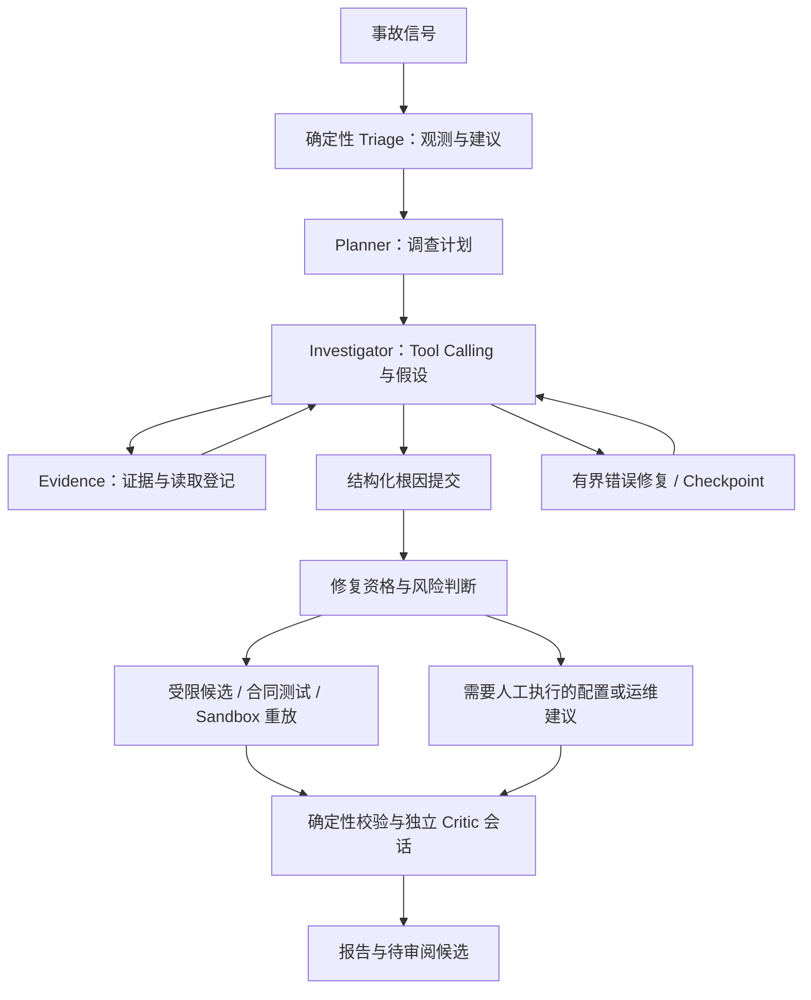

# Agent Runtime 与调查工作流

[文档导航](index.md) · [源码](../sentinel/runtime_agent.py) · [历史 Runtime 记录中文导读](phase4-runtime-zh.md)

本页说明当前仓库中自建 Python Runtime 的职责。项目没有使用 LangGraph 或外部 Multi-Agent 编排框架；Planner、Investigator、FixAgent、Critic 是代码协调的角色和独立调用阶段。

## 从事故到报告

`sentinel/api.py` 根据显式模式调用 `investigate_runtime`、历史 Hybrid 或规则实现。默认公开服务使用 `sentinel/public_demo.py`，不会进入上述实时执行链。Live API 默认调查模式仍为 `HYBRID_V2`；使用 Runtime V4.1 需显式选择 `HYBRID_V4_1`。

## 模块职责

| 模块 | 责任 |
| --- | --- |
| `runtime_agent.py` | `Runner` 协调阶段、模型请求、工具批次、候选验证和 Critic |
| `runtime_state.py` | Pydantic 状态、假设转移、预算、读取登记和提交就绪条件 |
| `runtime_tools.py` | 工具阶段检查、参数校验、回执恢复、证据落盘及模型结果投影 |
| `structured_output.py`、`field_repair.py` | 校验 JSON/schema；根据准确错误进行有界修复；只合并允许修复的字段 |
| `convergence.py`、`submission_contract.py` | 控制阶段推进及根因提交契约；接近预算时保留纠错能力 |
| `provider.py` | 兼容 Chat Completions 的 HTTP 请求、真实用量与公开响应日志 |
| `checkpoints.py`、`storage.py` | 状态、事件、证据、调用账本及恢复读写 |

## 状态与预算

状态独立于聊天历史，保存假设、关键证据、错误、未完成动作、读取范围、阶段和 Provider 诊断。P0 错误与 P1 关键状态不能随普通对话摘要被静默丢弃。假设区分 `CREATED`、`UPDATED`、`SUPPORTED`、`REJECTED`、`CONFIRMED`，非法转移返回结构化错误。

Runtime 分开核算探索、补证、纠错、提交、schema 修复和 Provider 重试。预算数值以 `runtime_state.py` 和运行配置为准；历史版本的限制不应直接套用到另一版本。达到硬限制时明确终止，不能靠无限重试或静默回退生成“成功”结果。

工具错误可包含 `error_code`、`invalid_fields`、`expected`、`actual` 和 `suggested_action`。它们是控制反馈，不是微服务故障证据。重复相同失败会触发熔断；实际调用与错误都保留在账本中。

## 根因、Critic 与部署的区别

根因提交必须引用本次调查有效且实际读取的证据。确定性校验检查结构、来源和约束；模型 Critic 使用独立会话复核，仍可能与 Investigator 产生相关错误。`PARTIALLY_VERIFIED` 表示部分验证，不是准确率或置信概率。

四类通用候选禁止自动 Apply。历史旧版定价覆盖入口与当前通用候选不是同一种发布机制。生成候选、合同测试通过、HTTP 重放通过、Critic 判定和生产部署均应分别报告。

## 历史与当前边界

冻结 V4.1 完成 8/8、根因正确 7/8；八场 Critic 输入均存在必需引用遗漏。当前代码要求保留必需证据并拒绝未交付引用，离线重打包六场可容纳、两场显式超限；尚未在当前源码上重跑完整付费 Benchmark。详见 [独立审计导读](independent-final-audit-zh.md)。
